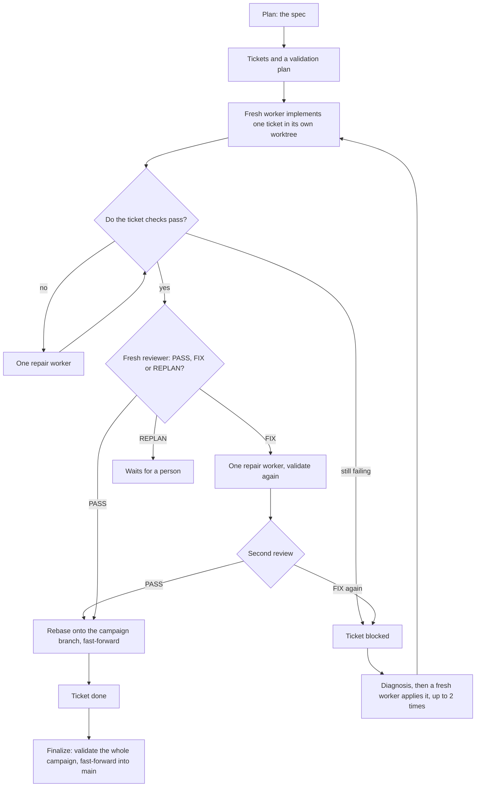
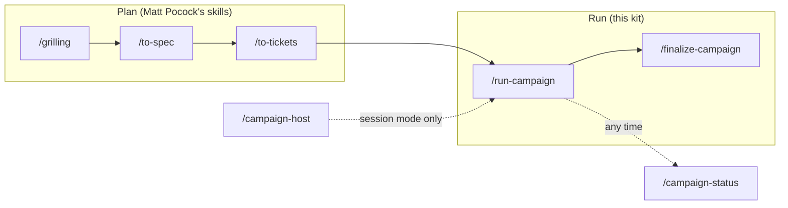
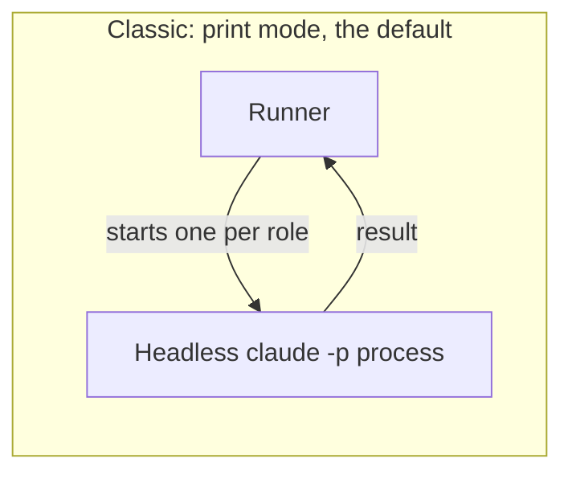
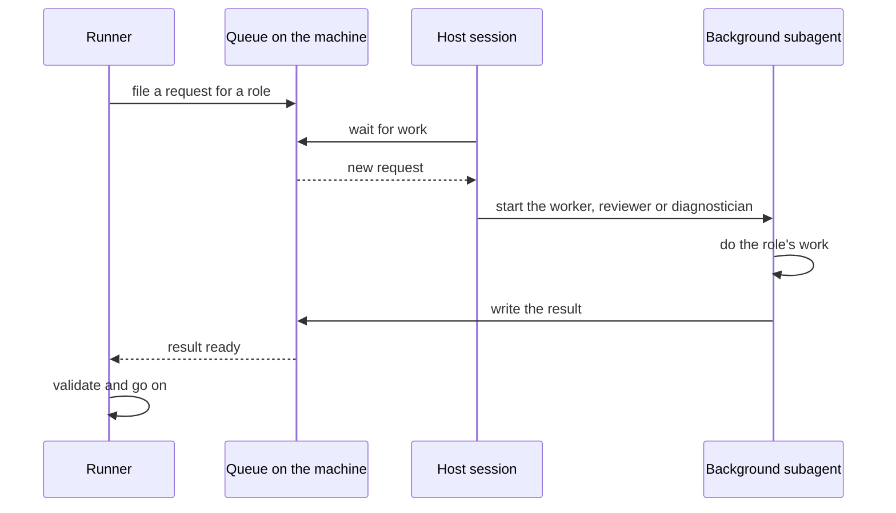

# Stakhanov

Hand a planned piece of work to AI coding agents and get it back built, checked, reviewed and merged.

Stakhanov is a kit you install into a Git project. It lets coding agents (Claude, Codex or Grok) carry out a
plan, ticket by ticket, mostly without you. A runner with no model of its own does the bookkeeping, and your
project's own commands decide whether the work is good.

The name: Alexei Stakhanov was the Soviet miner who cut fourteen times his quota of coal in a single shift.
Here the agents work the shifts.

## At a glance

| | |
| --- | --- |
| **What it does** | Runs a planned piece of work (a *campaign* of *tickets*) through AI agents. Each ticket is built, tested with your commands, reviewed by a second agent and merged. When all tickets are done, one last check lands the result on your main branch. |
| **When you need it** | The work is bigger than one chat session, it splits into several tickets, and you want it to run for hours without you watching. Or you have a single, well-described job to hand off (a *task*, which is a campaign of one ticket). |
| **How you use it** | Install it once per project with `install.sh`. Then you work with five slash commands in your agent: `/grilling`, `/to-spec`, `/to-tickets`, `/run-campaign` and `/finalize-campaign`. `/campaign-status` shows the board, and `/campaign-host` is for session mode. |

> [!NOTE]
> Linux only. You need `git` and at least one agent CLI: `claude`, `codex` or `grok`. The installer can install what
> is missing.

## The problem it solves

A coding agent works well on one change at a time. A larger job needs more than that: someone must cut it into
pieces, keep the pieces from colliding, run the tests, ask for a second opinion, retry what fails, and merge the
results in a safe order. Doing that by hand in one long chat is slow and fragile.

Stakhanov does that bookkeeping with a plain program, not with a model. The program follows fixed rules, so the same
campaign behaves the same way tomorrow. The agents do only the creative work: writing code and reviewing it.

## Words used here

| Term | Meaning |
| --- | --- |
| **Campaign** | A planned piece of work: a written spec and a set of tickets. It has its own branch, `campaign/<slug>`. |
| **Ticket** | One unit of work with a goal, its dependencies and the commands that prove it is done. |
| **Worktree** | A separate checkout of the repository in its own folder. Each ticket gets one, so agents never step on each other or on your files. |
| **Runner** | The program that drives a campaign. It has no model. It starts agents, runs your checks and merges. |
| **Worker** | A fresh agent process that implements one ticket. |
| **Reviewer** | A second, fresh agent that reads the result and may only read: it answers `PASS`, `FIX` or `REPLAN`. |
| **Diagnostician** | An agent that studies why a ticket keeps failing, so the next worker can fix the cause. |
| **Finalize** | The last step: validate the whole campaign once more, then merge it into your main branch. |

## How a campaign flows

1. **Plan.** You and your agent refine the idea (`/grilling`) and write a spec (`/to-spec`).
2. **Tickets.** The spec becomes tickets plus a validation plan, the list of commands that prove the work (`/to-tickets`).
3. **Work.** For each ticket whose dependencies are done, the runner creates a worktree and starts a fresh worker. Tickets that do not touch the same files run in parallel (2 workers by default, up to 3).
4. **Validation.** Before the worker starts, the runner checks that the ticket's commands fail on the code as it is, so the ticket's tests really prove the change. After the worker, it commits the change and runs the ticket's commands (tests, linters, builds). If a command fails, one repair worker gets a chance.
5. **Review.** A fresh reviewer reads the change. `PASS` moves on. `FIX` sends concrete findings to one repair worker and then to a new review. `REPLAN` stops the ticket and waits for a person.
6. **Integration.** The ticket is rebased onto the campaign branch and merged by fast-forward. If it conflicts, a worker resolves the conflict and the ticket is validated and reviewed again.
7. **Finalize.** When every required ticket is done, the final validation runs once on the whole campaign, the planning files are removed, and the campaign is merged into your main branch by fast-forward.

```
plan --> tickets --> worker --> validation --> review --> integration --> finalize
                        ^            |             |
                        +-- repair, diagnosis, recovery
```



A blocked ticket does not stop the tickets that do not depend on it. The runner pauses only when nothing else can run.

> [!NOTE]
> Runtime state (prompts, results, logs, receipts) lives in a cache folder (`~/.cache/agentic` by default), never in
> Git. Your repository only receives the work itself.

## The skills

You drive Stakhanov with slash commands. `/grilling`, `/to-spec` and `/to-tickets` are Matt Pocock's planning skills
(https://github.com/mattpocock/skills); the installer fetches them. The other four ship with this kit.



**`/run-campaign`** starts the campaign of the branch you are on, or attaches to it if it already runs. It asks how
you want to run: *interactive* (you follow the events in the session) or *unattended* (the runner keeps going after
you close the session). Pass `interactive` or `unattended` to skip the question.

**`/finalize-campaign`** finishes a campaign whose tickets are all done. It rebases the campaign onto the main branch
if that moved, runs the final validation, removes the planning files, merges into the main branch by fast-forward,
archives the history and deletes the campaign's branches and worktrees. It refuses to start if a required ticket is
not done, a worker is still running, or Git is in an unsafe state.

**`/campaign-status`** shows a read-only board: every campaign, every campaign queue and every loose worker round on
this machine and on the other machines of your fleet. Each ticket has an icon for its state, the phase it is in (for
example implementing, validating or in review), what comes next, and how long it has run.

**`/campaign-host`** is for session mode (below). It turns the Claude session where you run it into the place where
campaign roles run as background subagents. `/campaign-host stop` ends that.

## Running roles inside your interactive session

Normally the runner starts every role (worker, reviewer, diagnostician) as its own headless `claude -p` process. On a
Claude subscription, headless traffic is currently metered heavier on the 5-hour usage window than the interactive
client: public measurements put it at about 1.6x to 3x for the same tokens
([anthropics/claude-code#97074](https://github.com/anthropics/claude-code/issues/97074)). Subagents of an interactive
session count as that session.

Session mode avoids that. You open one ordinary interactive Claude Code session and run `/campaign-host` in it. The
runner then leaves each role as a request in a queue on the machine, and that host session runs it as a background
subagent. Nothing else in the campaign changes: validation, review, integration, retries and finalize work as before.





To use it:

1. Set `"env": {"AGENTIC_CLAUDE_MODE": "session"}` in `.agentic/project.json` and commit it (or export the variable).
   Set it back to `print` to return to the classic path.
2. Open `claude` in the project, with permissions that do not prompt, and run `/campaign-host`.
3. Run `/run-campaign` as usual. Leave the host session open; it only relays requests.

> [!WARNING]
> Nobody can answer a prompt inside a background subagent, so the host session must run without permission prompts
> (for example `claude --permission-mode bypassPermissions`). Subagents inherit that. Use a session you dedicate to
> hosting.

What to expect:

- **No time limit while it works.** A subagent that shows no sign of work for 10 minutes is stopped
  (`AGENTIC_SESSION_IDLE_SECONDS`, 600 seconds). Signs of work are its transcript growing, and CPU or disk activity of
  the command it waits on.
- **If the host dies, the requests wait.** Reopen the session (resume it and run `/campaign-host` again) and
  interrupted work goes back into the queue. In a terminal, udarnik's `keep` can reopen it automatically when udarnik
  is installed. T3 Code restarts its own threads, so udarnik leaves those alone.
- **Without a host, a run waits.** The runner retries until a host session is open.
- **Claude only.** Codex and Grok roles are not affected.

The technical description is in [`agentic/providers/claude/README.md`](agentic/providers/claude/README.md).

## Install

From a copy of this repository:

```
./install.sh <project-dir>
```

`<project-dir>` must be the top level of a Git work tree. The command prepares the machine (missing system commands,
agent CLIs, Matt Pocock's skills) and then installs the kit in the project:

- the engine, in `.agentic/`, with its documents and the settings file `.agentic/project.json`;
- the skills, in `.claude/skills/` (and `.codex/skills/` and `.grok/skills/` for those providers), and for Claude the
  three role agents in `.claude/agents/`;
- a block of workflow rules in `AGENTS.md`, between `<!-- stakhanov:start -->` and `<!-- stakhanov:end -->`. The rest
  of the file is never touched.

The installer never commits and never logs in to an agent CLI: open each CLI it installed once to sign in. Later, run
it with `--update` to refresh the kit.

> [!IMPORTANT]
> Commit the installed files on your main branch before you run `/to-spec`. A campaign starts from the committed kit,
> and `campaign init` refuses a main branch without it. Edits to `.agentic/project.json` apply once committed too.

All options, what the machine setup does and the details of each step are in the
[technical reference](docs/REFERENCE.md#install).

## From an idea to a finished campaign

| Step | What you do | Command |
| --- | --- | --- |
| 1 | Install the kit and commit it on the main branch. | `./install.sh <project-dir>` |
| 2 | Stress-test the idea. The agent asks you questions; no files are written. | `/grilling` |
| 3 | Write the spec and create the campaign branch and worktree, from the main branch. | `/to-spec`, then `campaign init <spec> --slug <name>` |
| 4 | Turn the spec into tickets and a validation plan, committed on the campaign branch. Check them. | `/to-tickets`, then `campaign verify` |
| 5 | Open your agent in the campaign worktree. `campaign status` prints its path. | `cd <worktree>` |
| 6 | Start the runner, or attach to it. | `/run-campaign` (or `/run-campaign unattended`) |
| 7 | Look at progress when you want. | `/campaign-status`, `campaign status` |
| 8 | Answer the rare decision that needs you, or recover a stuck ticket. | `campaign decide <ticket> <retry\|block\|cancel>`, `campaign recover <ticket>` |
| 9 | When every required ticket is done, land the campaign. | `/finalize-campaign` |

The `campaign` command is `.agentic/bin/campaign` in your project.

> [!TIP]
> For a long unattended run, `campaign watch` waits until the campaign needs you (a decision, a blocked ticket, a
> stalled agent or the end) and stays silent otherwise. The agent that coordinates the campaign can use it instead of
> polling.

**One-off tasks.** For a single, well-described job there is a lighter path: write a brief (see `.agentic/TASK.md`)
and run `campaign task new <brief>`. A task is a campaign of one ticket whose plan is not committed. `campaign task
accept <name>` validates it and fast-forwards it into the main branch.

## FAQ

**Does it commit to my main branch?**
Not while it works. Each ticket is built on its own branch in its own worktree. Finished tickets merge into the
campaign branch, `campaign/<slug>`. Your main branch moves only when you run `/finalize-campaign`, and then only by
`git merge --ff-only` after the final validation, so there is never a merge commit. Stakhanov does not push. The
installer never commits either.

**What if a worker fails?**
It depends on the failure.

- A failing check gets one repair worker.
- A reviewer's `FIX` gets one repair worker and a second review.
- A ticket that still ends up blocked gets up to two automatic recoveries. The evidence of the last attempt becomes a
  diagnosis, and a fresh worker applies it.
- A problem of the machine, such as a missing command or a command that hit its deadline, blocks the ticket without
  retries. Fix the machine, then run `campaign recover <ticket>`.
- A question only you can answer (an ambiguous requirement, a changed requirement or a risky destructive step) waits
  for `campaign decide`.
- If the runner crashes or the computer reboots, a supervisor restarts a campaign that should be running, when your
  user has systemd.
- If a usage limit is hit and you set up several Claude accounts, the call moves to another account; if every account
  is out, the ticket waits and runs again without spending an attempt.

**Can I stop it?**
Yes. `campaign stop` starts no new ticket and lets the running ones end. `campaign stop --now` stops at once; the next
run recovers the interrupted work. `campaign restart` stops and runs again with the same settings.

**What runs where?**
The runner and the agents run on your machine, in worktrees next to your repository. The runner is a shell and Python
program with no model. Runtime state is in the cache folder, not in Git. If you want, remote executors run the workers
on other Linux machines, and a fleet lets several machines run whole campaigns and be controlled from any of them (see
the [reference](docs/REFERENCE.md#several-machines)).

**What does session mode change?**
Only where the roles run: as background subagents of one interactive Claude session instead of separate `claude -p`
processes. The campaign itself, its checks and its merges are the same. See [the section above](#running-roles-inside-your-interactive-session).

**Which agents can I use?**
`claude`, `codex` or `grok`; one is enough. Session mode is for Claude.

**Does it touch my instruction files?**
The installer adds a marked block to `AGENTS.md` and leaves `CLAUDE.md` alone. Workers may not edit instruction files,
the `.agentic` folder or the skill folders; the runner rejects a ticket that does, even when the worker committed the change
itself. A Claude role also cannot edit files through the shell (`sed -i`, redirections) or write to git: it edits with its
Edit and Write tools, and the runner commits.

## Where to go next

- [`docs/REFERENCE.md`](docs/REFERENCE.md): the technical page. Installer options, machine setup, controlling
  campaigns, several machines, session mode commands, the layout of this repository and its tests.
- [`agentic/README.md`](agentic/README.md): the engine reference, installed in projects as `.agentic/README.md`. The
  settings, every `AGENTIC_*` environment variable, the ticket lifecycle, tasks, executors and the fleet.
- [`agentic/providers/claude/README.md`](agentic/providers/claude/README.md): the Claude adapter and its session mode.
